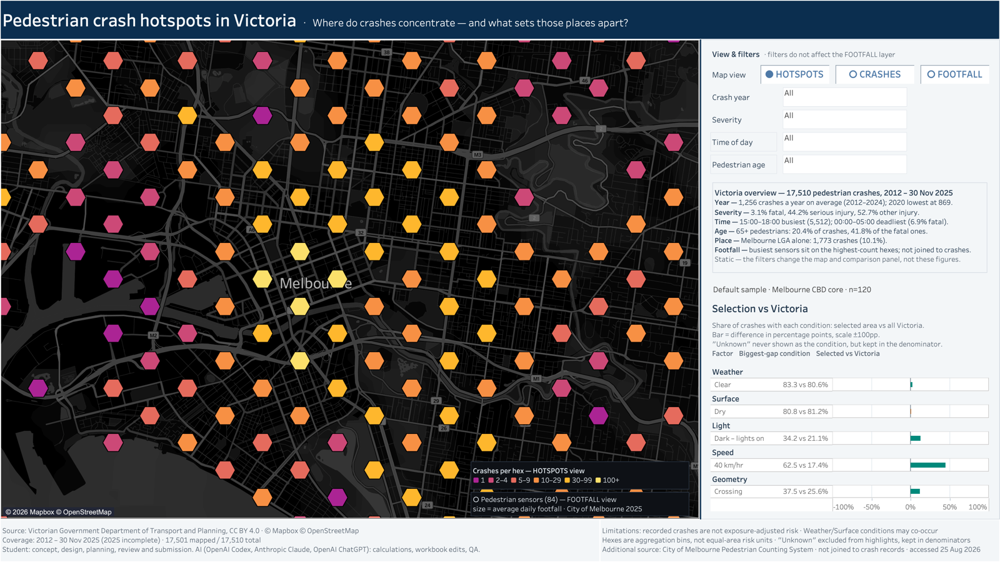

# 维州行人事故热点地图 · Victorian Pedestrian Crash Hotspots

墨尔本大学 GEOM90007 信息可视化课程的个人作业，2026 年 8 月用 Tableau 完成。得分 84.3/100，班均 70.0。

[English below](#english)

## 这个看板解决什么问题

作业设定的读者是维州交通部门（Transport Victoria）。他们要调查行人事故，再决定在哪些地方采取措施。看板回答两个问题：事故集中在哪里？这些地方和全州比有什么不同？

## 做了什么

- 把 2012 年到 2025 年 11 月 30 日的 17,510 起行人事故放进一张看板。其中 17,501 起有坐标，画在地图上。
- 地图有三种视图：六边形热点（HOTSPOTS）、单起事故（CRASHES）和墨尔本市 84 个行人流量传感器（FOOTFALL）。
- 四个筛选器：事故年份、严重程度、时段和行人年龄。
- 在地图上选中任一区域，右侧面板会把这个区域和全州对比，看天气、路面、光线、限速和道路形态五类条件下的事故占比。
- 页脚写明局限：事故数不等于按人流折算的风险；传感器数据只作背景，没有和事故记录关联。

## 结果

- 得分 84.3/100，班均 70.0（291 人）。
- 看板上能直接读到几条发现。比如，65 岁以上行人占全部事故的 20.4%，却占死亡事故的 41.8%；15:00～18:00 的事故最多。

## 怎么打开

用 Tableau Desktop 或免费的 Tableau Public 打开 `GEOM90007_A1_Pedestrian_Crash_Map_JiakuoTang.twbx`。文件用 Tableau 2026.2 保存，旧版本可能打不开。数据已经打包在文件里，不用另外下载。

这个文件就是交到 Canvas 的那一份，没有改过，SHA-256 是 `0afe789fa1d97492370d06963cb0fc4103eb74d1d389af0659d5d9292635e8a6`。截图也是用这个文件渲染的。

## 数据来源

- 事故数据：维州交通与规划部（Department of Transport and Planning）的 Victoria Road Crash Data，CC BY 4.0。课程提供了整理好的版本。
- 行人流量：墨尔本市政府的 Pedestrian Counting System。传感器位置表是 CC BY 4.0；逐小时计数表的数据页没有写许可，文件里只放了用它算出的 2025 年各传感器日均人流（84 行）。
- 底图：© Mapbox © OpenStreetMap。

## AI 使用说明

看板页脚的原文是：

> Student: concept, design, planning, review and submission. AI (OpenAI Codex, Anthropic Claude, OpenAI ChatGPT): calculations, workbook edits, QA.

选题、设计、规划、检查和提交由我完成。Tableau 计算字段、工作簿修改和 QA 由 AI 编码助手完成。

## 使用限制

这个仓库用来展示作品，没有开放许可。请不要把它用于课程作业。数据按上面各自的许可使用。

---

## English

A solo assignment for GEOM90007 Information Visualisation at the University of Melbourne, built in Tableau in August 2026. Mark: 84.3/100 (class mean 70.0).

### The problem

The brief's audience is Transport Victoria, which investigates pedestrian crashes and decides where to act. The dashboard answers two questions: where do crashes concentrate, and what sets those places apart from the rest of Victoria?

### What I built

- 17,510 pedestrian crashes from 2012 to 30 November 2025 in one dashboard. 17,501 of them have coordinates and are mapped.
- Three map views: hex hotspots (HOTSPOTS), individual crashes (CRASHES) and 84 City of Melbourne pedestrian sensors (FOOTFALL).
- Four filters: crash year, severity, time of day and pedestrian age.
- Select any area on the map, and the side panel compares its share of crashes under five conditions (weather, surface, light, speed zone and road geometry) with all of Victoria.
- The footer states the limits: crash counts are not exposure-adjusted risk, and the sensor data is context only, not joined to crash records.

### Result

- 84.3/100, class mean 70.0 (291 students).
- Findings you can read straight off the dashboard: pedestrians aged 65+ are 20.4% of all crashes but 41.8% of fatal ones, and 15:00–18:00 has the most crashes.

### Opening it

Open `GEOM90007_A1_Pedestrian_Crash_Map_JiakuoTang.twbx` in Tableau Desktop or the free Tableau Public app. It was saved with Tableau 2026.2, so older versions may not open it. The data is packaged inside the file.

This is the exact file submitted on Canvas (SHA-256 above). The screenshot was rendered from it.

### Data

- Crashes: Victoria Road Crash Data, Department of Transport and Planning, CC BY 4.0, as prepared for the course.
- Pedestrian volume: City of Melbourne Pedestrian Counting System. The sensor-location table is CC BY 4.0. The hourly-count table's page states no licence, so the workbook only includes per-sensor 2025 average daily counts derived from it (84 rows).
- Basemap: © Mapbox © OpenStreetMap.

### AI use

Quoted from the dashboard footer: "Student: concept, design, planning, review and submission. AI (OpenAI Codex, Anthropic Claude, OpenAI ChatGPT): calculations, workbook edits, QA."

### Use

Shared as a portfolio piece. There is no open licence; please don't reuse it for coursework. The data stays under the licences listed above.
