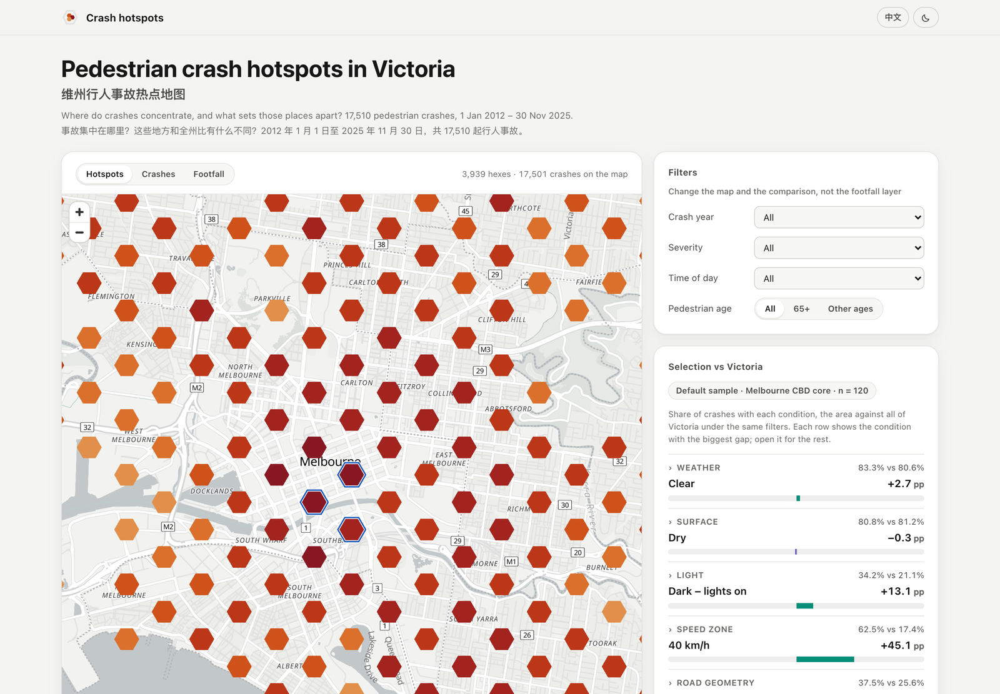
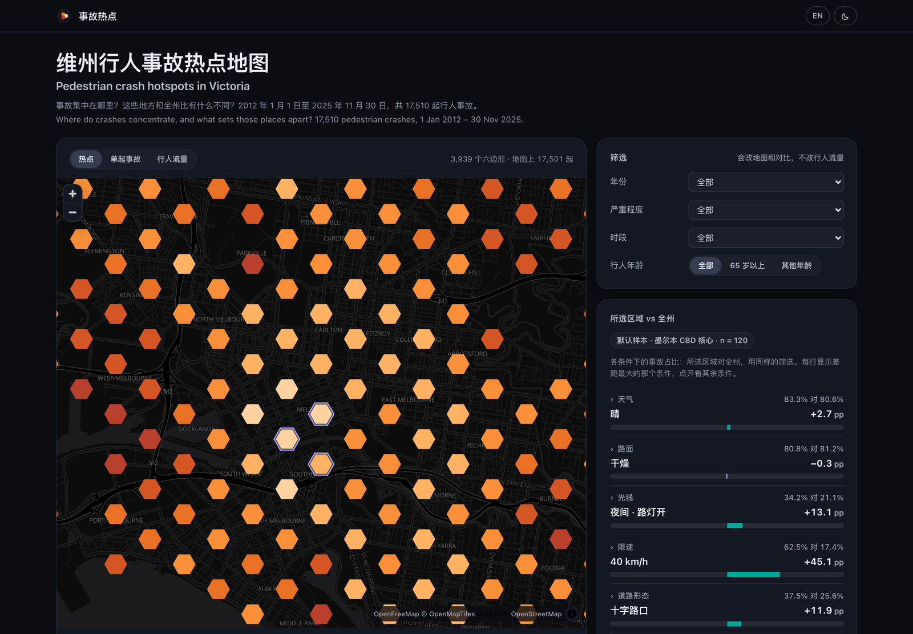
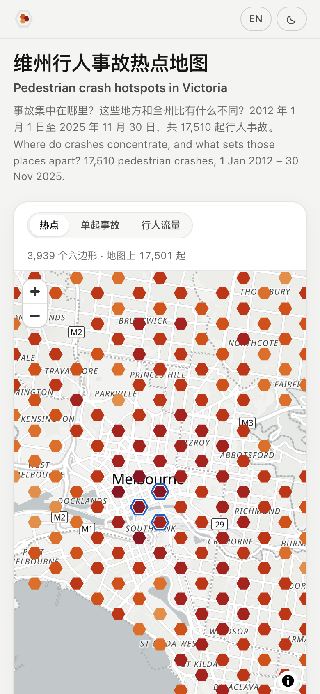
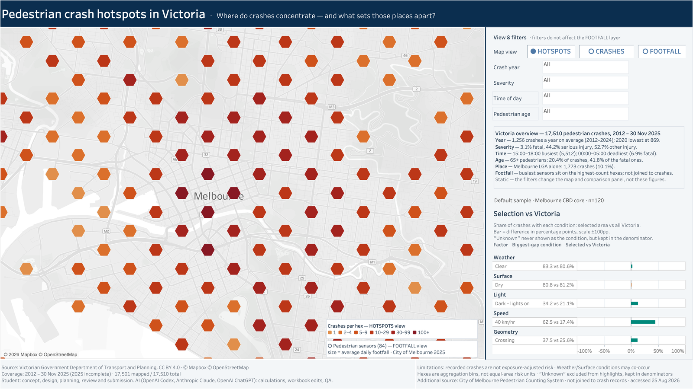

# Victorian Pedestrian Crash Hotspots · 维州行人事故热点地图

Where pedestrian crashes concentrate in Victoria, and what sets those places apart: 17,510 crashes from 2012 to November 2025 on one map. 
维州的行人事故集中在哪里，这些地方和全州比有什么不同：2012 年到 2025 年 11 月的 17,510 起事故放在一张地图上。

**[Live demo · 在线演示](https://wannian001.github.io/vic-pedestrian-crash-map/)** (no Tableau needed · 不用装 Tableau) &nbsp;·&nbsp; [English](#english) &nbsp;·&nbsp; [中文](#中文)

## English

A solo assignment for GEOM90007 Information Visualisation at the University of Melbourne, built in Tableau in August 2026. Mark: 84.3/100 (class mean 70.0).

In October 2026 a light version was added next to the submitted file (only the map colours changed; see [Recoloured after submission](#recoloured-after-submission)), plus a [web version](#web-version) that opens without Tableau.

### The problem

The brief's audience is Transport Victoria, which investigates pedestrian crashes and decides where to act. The dashboard answers two questions: where do crashes concentrate, and what sets those places apart from the rest of Victoria?

### What I built

- 17,510 pedestrian crashes from 2012 to 30 November 2025 in one dashboard. 17,501 of them have coordinates and are mapped.
- Three map views: hex hotspots (HOTSPOTS), individual crashes (CRASHES) and 84 City of Melbourne pedestrian sensors (FOOTFALL).
- Four filters: crash year, severity, time of day and pedestrian age.
- Select any area on the map, and the side panel compares its share of crashes under five conditions (weather, surface, light, speed zone and road geometry) with all of Victoria.
- The footer states the limits: crash counts are not exposure-adjusted risk, and the sensor data is context only, not joined to crash records.

### Result

- 84.3/100, class mean 70.0 (291 students).
- Findings you can read straight off the dashboard: pedestrians aged 65+ are 20.4% of all crashes but 41.8% of fatal ones, and 15:00–18:00 has the most crashes.

### Web version

**[Open it](https://wannian001.github.io/vic-pedestrian-crash-map/)**. `web/` rebuilds the dashboard as a web page with the same data and the same rules. It wears the [dayring design kit](https://github.com/wannian001/dayring/blob/main/docs/DESIGN_KIT.md) (1.2.0): the title and summary are in both languages, the rest follows the 中文 / EN button (first visit: your browser's language), light or dark follows your system, and it works on phones and laptops.

  
  

- Same features as the dashboard: hotspots, single crashes and footfall views; year, severity, time-of-day and pedestrian-age filters; click or box-select an area to compare five conditions with Victoria. Each factor opens to show every condition.
- Same numbers. `tools/build_web_data.py` builds `web/data/` from the course data and checks it against the figures on the dashboard (totals, the default sample of 120, the five comparisons, the overview, the five time bands); any mismatch stops the build. Hexes use the exact reproduction of Tableau's HEXBIN made during the assignment, so every bin holds the same crashes.
- Light mode uses the light palette (more crashes = darker); dark mode flips it on a dark basemap (more = lighter). Both ramps and the higher / lower colours were checked with a palette validator.
- Basemap: OpenFreeMap (free, no key) drawn with MapLibre GL.

To preview locally, run `python3 -m http.server 8797 --directory web` and open <http://localhost:8797>. Rebuild the data with `python3 tools/build_web_data.py <course data folder>`; run the tests with `node tests/model.test.mjs`.

### Opening the Tableau files

Open either file in Tableau Desktop or the free Tableau Public app. Both were saved with Tableau 2026.2, so older versions may not open them. The data is packaged inside each file.

| File | What it is | SHA-256 |
|---|---|---|
| `GEOM90007_A1_Pedestrian_Crash_Map_JiakuoTang.twbx` | The exact file submitted on Canvas, unchanged (dark basemap, [screenshot](screenshots/dashboard_default.png)) | `0afe789fa1d97492370d06963cb0fc4103eb74d1d389af0659d5d9292635e8a6` |
| `GEOM90007_A1_Pedestrian_Crash_Map_JiakuoTang_light.twbx` | The light version made after submission, colours only ([screenshot](screenshots/dashboard_light.png)) | `817ac0f5f8419e1c85f36b638e964f9b7bfd4540925e1c4691ecede5f3f3e3a8` |

Each screenshot was exported from its own file in Tableau.

### Recoloured after submission

The submitted version uses Tableau's dark basemap and a magma ramp in which more crashes means a brighter hex, so the map reads as heavy and dark. On a light background the usual rule for ordered data is the opposite: more means darker. The course's ColorBrewer and visual-hierarchy material uses the same rule. On 13 October 2026 a light version was made from the submitted file:

- The basemap changed from dark to light.
- The hexes use a single-hue orange-to-dark-red ramp, from `#e18f4b` for 1 crash to `#871823` for 100+. Lightness falls step by step with a visible gap between neighbours, and the lightest step keeps at least 2:1 contrast against the basemap (`#e8e8e8`).
- The two legend boxes on the map are now white with dark text, and their swatches match the new ramp.
- Individual crashes in the CRASHES view changed from white to dark red at 75% opacity, since white dots disappear on a light basemap. Sensor circles in the FOOTFALL view changed from light grey to mid grey.

Data, calculated fields, filters, interactions and layout are unchanged. `tools/make_light_version.py` builds the light file directly from the submitted one and lists every edit.

Known issue in both Tableau files: after you click the CRASHES or FOOTFALL button, the button text turns from blue to orange. Tableau assigns the button-state colours automatically. Switching views still works.

### Data

- Crashes: Victoria Road Crash Data, Department of Transport and Planning, CC BY 4.0, as prepared for the course.
- Pedestrian volume: City of Melbourne Pedestrian Counting System. The sensor-location table is CC BY 4.0. The hourly-count table's page states no licence, so only per-sensor 2025 average daily counts derived from it are included (84 rows).
- Basemaps: © Mapbox © OpenStreetMap in Tableau; OpenFreeMap, © OpenMapTiles, data © OpenStreetMap contributors on the web version.

### AI use

Quoted from the dashboard footer: "Student: concept, design, planning, review and submission. AI (OpenAI Codex, Anthropic Claude, OpenAI ChatGPT): calculations, workbook edits, QA." The light version and the web version were built, rendered and checked by Claude Code at my request; scripts check the numbers and I reviewed the result.

### Use

Shared as a portfolio piece. There is no open licence; please don't reuse it for coursework. The data stays under the licences listed above.

## 中文

墨尔本大学 GEOM90007 信息可视化课程的个人作业，2026 年 8 月用 Tableau 完成。得分 84.3/100，班均 70.0。

2026 年 10 月在提交版之外加了一份浅色版，只改了地图配色，见[提交后的改色](#提交后的改色)；另外做了一个不用装 Tableau 的[网页版](#网页版)。

### 这个看板解决什么问题

作业设定的读者是维州交通部门（Transport Victoria）。他们要调查行人事故，再决定在哪些地方采取措施。看板回答两个问题：事故集中在哪里？这些地方和全州比有什么不同？

### 做了什么

- 把 2012 年到 2025 年 11 月 30 日的 17,510 起行人事故放进一张看板。其中 17,501 起有坐标，画在地图上。
- 地图有三种视图：六边形热点（HOTSPOTS）、单起事故（CRASHES）和墨尔本市 84 个行人流量传感器（FOOTFALL）。
- 四个筛选器：事故年份、严重程度、时段和行人年龄。
- 在地图上选中任一区域，右侧面板会把这个区域和全州对比，看天气、路面、光线、限速和道路形态五类条件下的事故占比。
- 页脚写明局限：事故数不等于按人流折算的风险；传感器数据只作背景，没有和事故记录关联。

### 结果

- 得分 84.3/100，班均 70.0（291 人）。
- 看板上能直接读到几条发现。比如，65 岁以上行人占全部事故的 20.4%，却占死亡事故的 41.8%；15:00～18:00 的事故最多。

### 网页版

**[打开在线演示](https://wannian001.github.io/vic-pedestrian-crash-map/)**。`web/` 用同一份数据、同一套口径，把看板做成了网页。外观套用 [dayring 设计套件](https://github.com/wannian001/dayring/blob/main/docs/DESIGN_KIT.md)（1.2.0）：标题和简介中英两行都有，其余内容随「中文 / EN」按钮切换（第一次打开按浏览器语言），深浅色跟随系统，手机和电脑都能用。

- 功能和看板一样：热点、单起事故、行人流量三种视图；年份、严重程度、时段、行人年龄四个筛选器；点选或框选一块区域，和全州比五类条件。对比面板每类条件可以展开，看全部取值。
- 数字和看板逐项一致。`tools/build_web_data.py` 从课程原始数据生成 `web/data/`，每次都拿看板上的数字核对（总数、默认样本 n=120、五类对比、全州概况、五个时段的事故数），对不上就报错。六边形用的是当初逐条复现的 Tableau HEXBIN 算法，每个格子里的事故和看板一样。
- 浅色模式用提交后定的浅色配色（越多越深），深色模式在深色底图上反过来（越多越亮）。两套色带和“高于 / 低于全州”两种颜色都用色板校验脚本查过。
- 底图是 OpenFreeMap（免费，不需要密钥），地图引擎是 MapLibre GL。

本地预览：运行 `python3 -m http.server 8797 --directory web`，然后打开 <http://localhost:8797>。重新生成数据：`python3 tools/build_web_data.py <课程数据目录>`；测试：`node tests/model.test.mjs`。

### 怎么打开 Tableau 文件

用 Tableau Desktop 或免费的 Tableau Public 打开。文件用 Tableau 2026.2 保存，旧版本可能打不开。数据已经打包在文件里，不用另外下载。仓库里有两个文件：

| 文件 | 是什么 | SHA-256 |
|---|---|---|
| `GEOM90007_A1_Pedestrian_Crash_Map_JiakuoTang.twbx` | 交到 Canvas 的那一份，没有改过（深色底图，[截图](screenshots/dashboard_default.png)） | `0afe789fa1d97492370d06963cb0fc4103eb74d1d389af0659d5d9292635e8a6` |
| `GEOM90007_A1_Pedestrian_Crash_Map_JiakuoTang_light.twbx` | 提交后的浅色版，只改了配色（[截图](screenshots/dashboard_light.png)） | `817ac0f5f8419e1c85f36b638e964f9b7bfd4540925e1c4691ecede5f3f3e3a8` |

两张截图分别用对应的文件在 Tableau 里导出。

### 提交后的改色

提交版用的是 Tableau 的深色底图，六边形用 magma 色带，事故越多颜色越亮。整张地图偏暗。而在浅色背景上，顺序数据的通行画法是越多越深，课程讲 ColorBrewer 和视觉层级时用的也是这个规则。2026-10-13 在提交版的基础上做了浅色版：

- 底图从深色换成浅色。
- 六边形改成橙到深红的单色相色带：1 起 `#e18f4b`，100+ 起 `#871823`，越多越深。六档亮度依次递减，相邻两档拉开了差距；最浅一档对底图（`#e8e8e8`）的对比度在 2:1 以上，浅底上也看得见。
- 地图上的两个图例框改成白底深字，色块和新色带一致。
- CRASHES 视图里的单起事故点从白色改成深红（75% 不透明），否则在浅底图上看不见；FOOTFALL 视图的传感器圆点从浅灰改成中灰。

数据、计算字段、筛选器、交互和版面都没动。浅色版由 `tools/make_light_version.py` 从提交版直接生成，脚本里写明了每一处改动。

已知问题（两个 Tableau 文件都有）：在看板上点 CRASHES 或 FOOTFALL 按钮后，按钮文字会从蓝色变成橙色。这是 Tableau 给按钮状态自动分配颜色造成的，不影响切换功能。

### 数据来源

- 事故数据：维州交通与规划部（Department of Transport and Planning）的 Victoria Road Crash Data，CC BY 4.0。课程提供了整理好的版本。
- 行人流量：墨尔本市政府的 Pedestrian Counting System。传感器位置表是 CC BY 4.0；逐小时计数表的数据页没有写许可，这里只放了用它算出的 2025 年各传感器日均人流（84 行）。
- 底图：Tableau 版是 © Mapbox © OpenStreetMap；网页版是 OpenFreeMap，© OpenMapTiles，数据 © OpenStreetMap contributors。

### AI 使用说明

看板页脚的原文是：

> Student: concept, design, planning, review and submission. AI (OpenAI Codex, Anthropic Claude, OpenAI ChatGPT): calculations, workbook edits, QA.

选题、设计、规划、检查和提交由我完成。Tableau 计算字段、工作簿修改和 QA 由 AI 编码助手完成。提交后的浅色版和网页版由 Claude Code 按我的要求制作、渲染和检查，数字核对由脚本完成，我做了验收。

### 使用限制

这个仓库用来展示作品，没有开放许可。请不要把它用于课程作业。数据按上面各自的许可使用。
